  

## TL;DR

- Two decades of systems integration. I connect hardware and software to make physical systems work together, combining hands-on software development with system design and engineering leadership.
- Engineering Consultant at [Maveneer](https://maveneer.com). I design and integrate material handling, conveyors, goods-to-person robotics, and warehouse orchestration software.
- PepperDash, 2014–2025, from engineer to Director of Engineering Services, with hundreds of enterprise control system implementations.
- I build AI workflows and harnesses for engineering and software development.

## Tools I built for myself

- **[Maillard](https://github.com/jtalborough/maillard)**: an AI roast copilot for the Kaleido M10 coffee roaster.
- **[Magpie](https://github.com/jtalborough/magpie)**: an AI-run storage manager for the home and workshop.
- **[barCall](https://github.com/jtalborough/barCall)**: a macOS menu-bar app to join Zoom, Teams, and Webex calls.
- **jOS**: my personal operating system for running work and life with AI agents.

## Live feed

<!-- FEED:START -->
- Updated [paseo#1295](https://github.com/getpaseo/paseo/issues/1295) — Editable files + WYSIWYG markdown editing in the file viewer — 2026-10-17
- Closed [maillard#2](https://github.com/jtalborough/maillard/pull/2) — AI drum suggestions, auto TP/drop detection, one-screen roasting view, cooling-fan confirm — 2026-10-16
- Closed [maillard#1](https://github.com/jtalborough/maillard/pull/1) — fix(kaleido): stop turning short stalls into 6–32 s disconnects — 2026-10-16
- Pushed to [maillard](https://github.com/jtalborough/maillard/commit/5d7c00ecc4f2aa28818307141b6a4283681b24ab) — Add real UI screenshots from a simulator demo run — 2026-10-11
- Pushed to [magpie](https://github.com/jtalborough/magpie/commit/afb242fa0474ef75f3b534bcbee908b29de21491) — Add real UI screenshots from a demo run; move concept art into a collapsed section — 2026-10-11
- Updated [lobehub#15347](https://github.com/lobehub/lobehub/pull/15347) — 🐛 fix(desktop): detect gemini-cli when `--version` is a bare number — 2026-10-10
- Updated [codex#43057](https://github.com/openai/codex/issues/43057) — Codex desktop: pending question interface disappears after switching tabs and does not return — 2026-09-23

### Private work

Last 30 days: 614 commits across 14 active private repos.

Languages: Python 47% · TypeScript 22% · Go 15% · HTML 4% · JavaScript 2% · Shell 2% · PLpgSQL 1%.

Tech in the mix: Python, GitHub Actions, Docker, TypeScript, React, PostgreSQL, k3s, Kubernetes, C#/.NET, Ansible.
<!-- FEED:END -->

[LinkedIn](https://linkedin.com/in/jason-alborough) · [jason@designbuildautomate.io](mailto:jason@designbuildautomate.io)

Connect with me about hardware integration, robotics, and automation.
