  

## TL;DR

- Two decades of systems integration. I connect hardware and software to make physical systems work together, combining hands-on software development with system design and engineering leadership.
- Engineering Consultant at [Maveneer](https://maveneer.com). I design and integrate material handling, conveyors, goods-to-person robotics, and warehouse orchestration software.
- PepperDash, 2014–2025, from engineer to Director of Engineering Services, with hundreds of enterprise control system implementations.
- I build AI workflows and harnesses for engineering and software development.

## Tools I built for myself

- **[Maillard](https://github.com/jtalborough/maillard)**: an AI roast copilot for the Kaleido M10 coffee roaster.
- **[Magpie](https://github.com/jtalborough/magpie)**: an AI-run storage manager for the home and workshop.
- **[barCall](https://github.com/jtalborough/barCall)**: a macOS menu-bar app to join Zoom, Teams, and Webex calls.
- **jOS**: my personal operating system for running work and life with AI agents.

## Live feed

<!-- FEED:START -->
- Pushed to [curator-feed-903783cf](https://github.com/jtalborough/curator-feed-903783cf/commit/4f12bdfdffb359123c31abeb0b64bc13d9e0f366) — Market charts 2026-11-12 — 2026-11-12
- Opened [magpie#3](https://github.com/jtalborough/magpie/pull/3) — jco: builder templates magpie-code and magpie-cabinet — 2026-11-11
- Pushed to [magpie](https://github.com/jtalborough/magpie/commit/740e79cf8b3144c58451869501cd7b460f234a0c) — Fix the 5 failing tests on main (#2) — 2026-11-11
- Merged [magpie#2](https://github.com/jtalborough/magpie/pull/2) — Fix the 5 failing tests on main — 2026-11-11
- Opened [omnigent#9](https://github.com/jtalborough/omnigent/pull/9) — fix: make Hermes per-turn subprocess timeout configurable — 2026-11-11
- Opened [omnigent#7](https://github.com/jtalborough/omnigent/issues/7) — github_scope allows destructive gh api DELETE of git refs when allow_destructive is off — 2026-11-10
- Pushed to [omnigent](https://github.com/jtalborough/omnigent/commit/e6ff6c14d46457af17412faff837080df56b7db1) — fix: apply allow_destructive to gh api DELETE of git refs (#8) — 2026-11-10
- Merged [omnigent#8](https://github.com/jtalborough/omnigent/pull/8) — fix: apply allow_destructive to gh api DELETE of git refs — 2026-11-10
- Merged [magpie#1](https://github.com/jtalborough/magpie/pull/1) — Builder setup: AGENTS.md, magpie-builder definition, test CI — 2026-11-10
- Merged [omnigent#1](https://github.com/jtalborough/omnigent/pull/1) — Builder setup: fork rules and omnigent-builder definition — 2026-11-10
- Closed [omnigent#3](https://github.com/jtalborough/omnigent/issues/3) — Hermes pre_tool_call plugin callback times out at 30s, so Omnigent policy ASKs fail closed before a human can answer — 2026-11-10
- Merged [omnigent#6](https://github.com/jtalborough/omnigent/pull/6) — fix: cap Hermes policy hook long-poll under the 30s plugin timeout — 2026-11-10
- Closed [omnigent#4](https://github.com/jtalborough/omnigent/issues/4) — github_scope write_branches is literal names only, so feature-branch prefixes like rai/* cannot be allowed — 2026-11-10
- Merged [omnigent#5](https://github.com/jtalborough/omnigent/pull/5) — github_scope write_branches globs and zygote harness sys.argv — 2026-11-10
- Opened [omnigent#2](https://github.com/jtalborough/omnigent/issues/2) — Hermes zygote fork drops --conversation-id from sys.argv, so policy hooks and Omnigent MCP tools never load — 2026-11-10
- Merged [maillard#8](https://github.com/jtalborough/maillard/pull/8) — Let drop labels use a short letter series — 2026-10-30
- Pushed to [maillard](https://github.com/jtalborough/maillard/commit/599d56fe5b365f3641d541b37c8b0bdef5da24f8) — Let drop labels carry a short letter series. (#8) — 2026-10-30
- Closed [epi-biamp-tesira#102](https://github.com/PepperDash/epi-biamp-tesira/issues/102) — [BUG)-Configs with only Dialers will not properly subscribe for Dialer Feedback. — 2026-10-28
- Merged [maillard#7](https://github.com/jtalborough/maillard/pull/7) — Print each bag's entered net weight — 2026-10-28
- Updated [epi-utilities-devicemonitor#15](https://github.com/PepperDash/epi-utilities-devicemonitor/pull/15) — Development — 2026-10-27
- Updated [epi-utilities-devicemonitor#10](https://github.com/PepperDash/epi-utilities-devicemonitor/pull/10) — fix: issue where join were +1 when linking config in sharp devices — 2026-10-27
- Updated [epi-utilities-devicemonitor#9](https://github.com/PepperDash/epi-utilities-devicemonitor/pull/9) — Add new workflows — 2026-10-27
- Updated [epi-utilities-devicemonitor#4](https://github.com/PepperDash/epi-utilities-devicemonitor/pull/4) — Create betabuilds.yml — 2026-10-27
- Merged [maillard#5](https://github.com/jtalborough/maillard/pull/5) — Refresh README screenshots for the current dashboard — 2026-10-25
- Merged [maillard#6](https://github.com/jtalborough/maillard/pull/6) — Keep AI auto through link blips and govern development — 2026-10-25
- Merged [maillard#4](https://github.com/jtalborough/maillard/pull/4) — Make public maillard canonical: AI auto, drum auto-apply, auto cooling fans — 2026-10-24
- Closed [maillard#3](https://github.com/jtalborough/maillard/pull/3) — Canonical maillard: AI AUTO roast + deploy from public repo — 2026-10-24
- Closed [epi-videoCodec-ciscoExtended#28](https://github.com/PepperDash/epi-videoCodec-ciscoExtended/issues/28) — [BUG)-When EPI initializes while Codec is in a call the Active call. is not recognized and cannot be hung up. — 2026-10-21
- Updated [paseo#1295](https://github.com/getpaseo/paseo/issues/1295) — Editable files + WYSIWYG markdown editing in the file viewer — 2026-10-17
- Closed [maillard#2](https://github.com/jtalborough/maillard/pull/2) — AI drum suggestions, auto TP/drop detection, one-screen roasting view, cooling-fan confirm — 2026-10-16
- Closed [maillard#1](https://github.com/jtalborough/maillard/pull/1) — fix(kaleido): stop turning short stalls into 6–32 s disconnects — 2026-10-16

### Private work

Last 30 days: 250 commits across 14 active private repos.

Languages: Python 48% · TypeScript 20% · Go 16% · HTML 4% · JavaScript 3% · Shell 2% · PLpgSQL 1%.

Tech in the mix: Python, GitHub Actions, Docker, TypeScript, React, PostgreSQL, Kubernetes, C#/.NET, Ansible, k3s.
<!-- FEED:END -->

[LinkedIn](https://linkedin.com/in/jason-alborough) · [jason@designbuildautomate.io](mailto:jason@designbuildautomate.io)

Connect with me about hardware integration, robotics, and automation.

