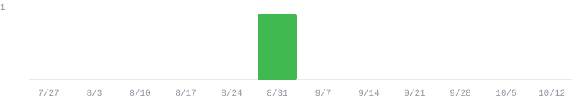

  

## TL;DR

- Two decades of systems integration. I connect hardware and software to make physical systems work together, combining hands-on software development with system design and engineering leadership.
- Engineering Consultant at [Maveneer](https://maveneer.com) since Apr 2025. I design and integrate material handling, conveyors, goods-to-person robotics, and warehouse orchestration software.
- PepperDash, 2014–2025, from engineer to Director of Engineering Services, with hundreds of enterprise control system implementations.
- I build AI workflows and harnesses for engineering and software development.

## Tools I built for myself

- **[Maillard](https://github.com/jtalborough/maillard)**: an AI roast copilot for the Kaleido M10 coffee roaster.
- **[Magpie](https://github.com/jtalborough/magpie)**: an AI-run storage manager for the home and workshop.
- **jOS**: my personal operating system for running work and life with AI agents.

## Live feed

<!-- FEED:START -->
- Closed [maillard#2](https://github.com/jtalborough/maillard/pull/2) — AI drum suggestions, auto TP/drop detection, one-screen roasting view, cooling-fan confirm — 2026-10-16
- Closed [maillard#1](https://github.com/jtalborough/maillard/pull/1) — fix(kaleido): stop turning short stalls into 6–32 s disconnects — 2026-10-16
- Pushed to [magpie](https://github.com/jtalborough/magpie/commit/9efcb997a1435cd0d697f5349bdee3a3229d6870) — Restore deploy and publish workflows, hardened for a public repo — 2026-10-11

### Private work

Last 7 days: 189 commits across 7 active private repos. Last 30 days: 593 commits across 12 active private repos.

Languages: Python 51% · TypeScript 36% · Shell 5% · Kotlin 2%.

Tech in the mix: k3s, Kubernetes, Docker, GitHub Actions, Python, TypeScript, React, PostgreSQL.

This week: automation and services.

Past weeks

- Week of 2026-10-12: 0 contributions. As of 2026-10-16: 189 commits across 7 active private repos in the last 7 days, 593 commits across 12 active private repos in the last 30 days. Languages: Python 51% · TypeScript 36% · Shell 5% · Kotlin 2%. Tech: k3s, Kubernetes, Docker, GitHub Actions, Python, TypeScript, React, PostgreSQL. Theme: automation and services.
- Week of 2026-10-05: 0 contributions.
- Week of 2026-09-28: 0 contributions.
- Week of 2026-09-21: 0 contributions.
- Week of 2026-09-14: 0 contributions.
- Week of 2026-09-07: 0 contributions.
- Week of 2026-08-31: 1 contribution.
- Week of 2026-08-24: 0 contributions.
- Week of 2026-08-17: 0 contributions.
- Week of 2026-08-10: 0 contributions.
- Week of 2026-08-03: 0 contributions.
- Week of 2026-07-27: 0 contributions.

<!-- FEED:END -->

[LinkedIn](https://linkedin.com/in/jason-alborough) · [jason@designbuildautomate.io](mailto:jason@designbuildautomate.io)

Connect with me about hardware integration, robotics, and automation.
