  

## TL;DR

- Two decades of systems integration. I connect hardware and software to make physical systems work together, combining hands-on software development with system design and engineering leadership.
- Engineering Consultant at [Maveneer](https://maveneer.com). I design and integrate material handling, conveyors, goods-to-person robotics, and warehouse orchestration software.
- PepperDash, 2014–2025, from engineer to Director of Engineering Services, with hundreds of enterprise control system implementations.
- I build AI workflows and harnesses for engineering and software development.

## Tools I built for myself

- **[Maillard](https://github.com/jtalborough/maillard)**: an AI roast copilot for the Kaleido M10 coffee roaster.
- **[Magpie](https://github.com/jtalborough/magpie)**: an AI-run storage manager for the home and workshop.
- **[barCall](https://github.com/jtalborough/barCall)**: a macOS menu-bar app to join Zoom, Teams, and Webex calls.
- **jOS**: my personal operating system for running work and life with AI agents.

## Live feed

<!-- FEED:START -->
- Pushed to [orca](https://github.com/jtalborough/orca/commit/248499d1125f9cd752c547bfe7578123c23e3578) — docs(cli): specify the environment for remote worktree parents — 2026-11-21
- Opened [orca#1](https://github.com/jtalborough/orca/pull/1) — docs(cli): explain how to keep agent handoffs under their parent — 2026-11-21
- Opened [orca#46349](https://github.com/stablyai/orca/pull/46349) — docs(cli): explain how to keep agent handoffs under their parent — 2026-11-21
- Opened [orca#46348](https://github.com/stablyai/orca/issues/46348) — Document parent selection for related agent handoffs — 2026-11-21
- Opened [orca#45518](https://github.com/stablyai/orca/pull/45518) — fix(sidebar): Show single-workspace projects as one row — 2026-11-20
- Opened [orca#45515](https://github.com/stablyai/orca/issues/45515) — [Feature): Show single-workspace projects as one row inside project groups — 2026-11-20
- Opened [orca#44072](https://github.com/stablyai/orca/pull/44072) — fix(sidebar): align folder and Git workspace card identities — 2026-11-18
- Opened [orca#44071](https://github.com/stablyai/orca/issues/44071) — [Bug): Folder and Git workspace cards use inconsistent title alignment — 2026-11-18
- Pushed to [maillard](https://github.com/jtalborough/maillard/commit/c941f7f5bb39d93e3fc0a3393cfcff15f7dbda44) — Merge pull request #11 from jtalborough/fix/dashboard-asset-versioning — 2026-11-18
- Merged [maillard#11](https://github.com/jtalborough/maillard/pull/11) — Fingerprint Maillard dashboard assets across releases — 2026-11-18
- Closed [maillard#9](https://github.com/jtalborough/maillard/issues/9) — Fix charge-based timer and label printing/numbering workflow — 2026-11-18
- Merged [maillard#10](https://github.com/jtalborough/maillard/pull/10) — Start roast time at charge and restore label printing — 2026-11-18
- Pushed to [goat](https://github.com/jtalborough/goat/commit/c3b0e8b421f689760bff16561096ef15c10cc4f9) — feat(desktop): opt into using the fork as the main GOAT app — 2026-11-17
- Opened [goat#3673](https://github.com/goat-si/goat/pull/3673) — fix(agents): distinguish shared SSH terminals from remote agents — 2026-11-17
- Pushed to [curator-feed-903783cf](https://github.com/jtalborough/curator-feed-903783cf/commit/7d4195999ceffb65d82fe5084d62f2e357792218) — Update feed (2026-11-14 05:10) — 2026-11-14
- Opened [magpie#3](https://github.com/jtalborough/magpie/pull/3) — jco: builder templates magpie-code and magpie-cabinet — 2026-11-11
- Merged [magpie#2](https://github.com/jtalborough/magpie/pull/2) — Fix the 5 failing tests on main — 2026-11-11
- Pushed to [magpie](https://github.com/jtalborough/magpie/commit/740e79cf8b3144c58451869501cd7b460f234a0c) — Fix the 5 failing tests on main (#2) — 2026-11-11
- Opened [omnigent#9](https://github.com/jtalborough/omnigent/pull/9) — fix: make Hermes per-turn subprocess timeout configurable — 2026-11-11
- Opened [omnigent#7](https://github.com/jtalborough/omnigent/issues/7) — github_scope allows destructive gh api DELETE of git refs when allow_destructive is off — 2026-11-10
- Merged [omnigent#8](https://github.com/jtalborough/omnigent/pull/8) — fix: apply allow_destructive to gh api DELETE of git refs — 2026-11-10
- Merged [magpie#1](https://github.com/jtalborough/magpie/pull/1) — Builder setup: AGENTS.md, magpie-builder definition, test CI — 2026-11-10
- Merged [omnigent#1](https://github.com/jtalborough/omnigent/pull/1) — Builder setup: fork rules and omnigent-builder definition — 2026-11-10
- Closed [omnigent#3](https://github.com/jtalborough/omnigent/issues/3) — Hermes pre_tool_call plugin callback times out at 30s, so Omnigent policy ASKs fail closed before a human can answer — 2026-11-10
- Merged [omnigent#6](https://github.com/jtalborough/omnigent/pull/6) — fix: cap Hermes policy hook long-poll under the 30s plugin timeout — 2026-11-10
- Closed [omnigent#4](https://github.com/jtalborough/omnigent/issues/4) — github_scope write_branches is literal names only, so feature-branch prefixes like rai/* cannot be allowed — 2026-11-10
- Merged [omnigent#5](https://github.com/jtalborough/omnigent/pull/5) — github_scope write_branches globs and zygote harness sys.argv — 2026-11-10
- Opened [omnigent#2](https://github.com/jtalborough/omnigent/issues/2) — Hermes zygote fork drops --conversation-id from sys.argv, so policy hooks and Omnigent MCP tools never load — 2026-11-10
- Merged [maillard#8](https://github.com/jtalborough/maillard/pull/8) — Let drop labels use a short letter series — 2026-10-30
- Closed [epi-biamp-tesira#102](https://github.com/PepperDash/epi-biamp-tesira/issues/102) — [BUG)-Configs with only Dialers will not properly subscribe for Dialer Feedback. — 2026-10-28
- Merged [maillard#7](https://github.com/jtalborough/maillard/pull/7) — Print each bag's entered net weight — 2026-10-28
- Updated [epi-utilities-devicemonitor#15](https://github.com/PepperDash/epi-utilities-devicemonitor/pull/15) — Development — 2026-10-27
- Updated [epi-utilities-devicemonitor#10](https://github.com/PepperDash/epi-utilities-devicemonitor/pull/10) — fix: issue where join were +1 when linking config in sharp devices — 2026-10-27
- Updated [epi-utilities-devicemonitor#9](https://github.com/PepperDash/epi-utilities-devicemonitor/pull/9) — Add new workflows — 2026-10-27
- Updated [epi-utilities-devicemonitor#4](https://github.com/PepperDash/epi-utilities-devicemonitor/pull/4) — Create betabuilds.yml — 2026-10-27
- Merged [maillard#5](https://github.com/jtalborough/maillard/pull/5) — Refresh README screenshots for the current dashboard — 2026-10-25
- Merged [maillard#6](https://github.com/jtalborough/maillard/pull/6) — Keep AI auto through link blips and govern development — 2026-10-25
<!-- FEED:END -->

[LinkedIn](https://linkedin.com/in/jason-alborough) · [jason@designbuildautomate.io](mailto:jason@designbuildautomate.io)

Connect with me about hardware integration, robotics, and automation.

